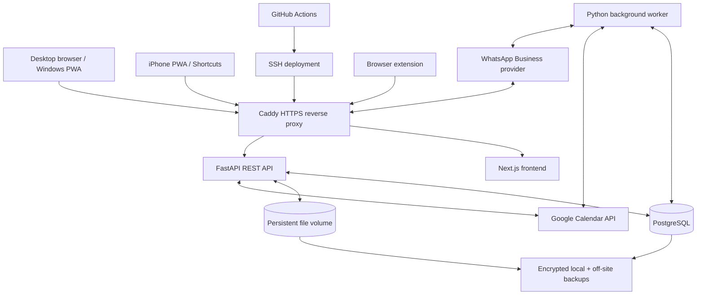

# Ethos — Product & Build Specification

**Version:** 1.0  
**Status:** Discovery closed; ready for implementation  
**Date:** 6 November 2026  
**Product owner:** Single-user personal deployment

> **Build principle:** Build the simplest system that faithfully delivers Ethos. Do not add features, abstractions, infrastructure or workflows merely because they might be useful someday.

---

## 1. Product definition

Ethos is a personal command centre for managing commitments, executing work, maintaining consistency and organising personal knowledge. It combines a visual productivity dashboard, a personal life-administration system and a lightweight personal knowledge management (PKM) library.

Ethos is **not a conversational assistant**. The user makes decisions. Ethos organises information, schedules commitments, executes clear commands, presents relevant facts and highlights the next action. Its interface is a visual dashboard with a keyboard-first command surface—not a chat window with a dashboard attached.

### 1.1 Product principles

1. **Consistency over perfection.** Help the user maintain routines and recover from missed sessions without guilt.
2. **Take ownership and get things done.** Prioritise execution over endless planning.
3. **Clear, direct and factual.** Report patterns and consequences without shame, guilt, insults or motivational speeches.
4. **User remains in control.** Execute unambiguous, low-risk commands; ask when essential information is missing or an operation is consequential.
5. **One connected system.** Tasks, projects, goals, habits, calendar entries and notes should link naturally without forcing every record into a project.
6. **Consistency in the interface.** A curated visual system, predictable navigation and purposeful motion.
7. **No overengineering.** Prefer a straightforward implementation that is easy to understand, operate and change.

### 1.2 Product outcomes

- Know what matters today and what to do next.
- Automatically place planned work into Google Calendar without silently moving fixed commitments.
- Make recurring habits visible and measurable.
- Capture tasks, reminders, ideas and knowledge from the places the user already works.
- Keep personal notes and clipped material connected to real projects and goals.
- Show honest progress and missed commitments without turning productivity into a guilt mechanism.

## 2. Scope

### 2.1 Included life areas

- Academics: coursework, assignments, exams and deadlines.
- Career: ordinary tasks, goals and projects for preparation and applications; no separate career-management module.
- Projects: simple project pages and associated work.
- Personal tasks and personal administration.
- Health and fitness: manual habit/workout/sleep logging.
- Relationships and social: basic reminders and calendar events only.
- Learning: represented through existing tasks, projects, goals, habits and notes; no separate Learning section.
- Ideas and knowledge: captured in the Notes library; new ideas do not automatically become projects.
- Long-term ambitions: goals connected to tasks, projects and habits.

**Explicit exclusions:** finance management, the inactive TRACE project, multi-user/team features, a conversational assistant, autonomous motivational messages, AI-generated knowledge graphs, automatic note summaries, automatic task decomposition, voice capture, and integrations that have not been discussed and approved.

### 2.2 Initial product shape

The desktop web application is the primary workspace. It is installable as a PWA on Windows. The iPhone experience is deliberately lighter: today's agenda, tasks, habits, notifications and quick capture. Both use the same cloud-hosted account and data.

The initial system is single-user only. There is no public registration, team workspace, sharing model or multi-tenant architecture.

## 3. User experience and navigation

### 3.1 Main navigation

Use a collapsible left sidebar. Expanded state shows icons and labels; collapsed state shows icons only.

Primary destinations:

- Home / Command Centre
- Tasks
- Projects
- Goals
- Habits
- Notes
- Analytics
- Inbox
- Settings

Do not build a separate Learning, Career, Relationships, Personal Administration or Finance application area. Those records are organised using the existing system and domain labels.

### 3.2 Home dashboard — Command Centre first

The home page is compact and information-dense. Its primary visual identity is the **Command Centre**. The **Consistency Engine** is the secondary signature element.

Home components, in order of importance:

1. Today's agenda: Google Calendar events and Ethos-created time blocks.
2. One highlighted **Next Action**.
3. Task command centre: pending, completed, overdue and relevant priorities.
4. Deadline radar: upcoming deadlines in 7-, 14- and 30-day windows.
5. Habit and consistency tracker.
6. Analytics snapshot: completion and consistency trends.
7. One manually curated quote of the day.

The dashboard should not become a widget playground. Its layout is curated and fixed. Empty sections remain visible with a clean empty state and a relevant action such as “Create project” or “Add goal”.

The dashboard is time-aware: morning emphasises the agenda and priorities; afternoon emphasises remaining commitments; evening emphasises outstanding work and completion status. Its overall layout must remain stable. A personalised time-appropriate greeting and date appear at the top.

### 3.3 Dedicated pages

Use the compact dashboard and more spacious, focused layouts on dedicated pages. The initial page set is Tasks, Projects, Goals, Habits, Notes, Analytics and Inbox. Keep each page focused; do not add complex project-management features such as mandatory milestones, dependencies or resource allocation.

### 3.4 Visual direction

The design should feel like a distinctive, premium product—not a generic admin template. Take inspiration from the clarity, restrained typography and polish often seen in Claude's interfaces, but do not copy another product's UI.

- Primary palette: cool dark graphite, charcoal and slate, with restrained blue/cyan accents.
- Provide both dark and light modes. Default to dark. The user manually switches themes; do not auto-switch based on system settings or time.
- Use one primary Ethos accent and subtle domain-specific colours only for tags, indicators and charts.
- Typography: clean, contemporary, highly readable sans-serif; strong but understated hierarchy.
- Dashboard: compact and dense. Dedicated pages: spacious and focused.
- Use custom visualisations for signature components: interactive timelines, consistency heatmaps, progress displays and custom SVG charts. Use standard charting approaches where they are more sensible; do not custom-build every chart without a reason.
- Use skeleton placeholders for loading states.
- Respect reduced-motion preferences and keep animation performant.

**UI stack:** shadcn/ui + Tailwind CSS; Motion for React for normal component, layout and interaction motion; anime.js for selected custom timelines or complex visual effects. CSS transitions are sufficient for simple hover/focus effects. Avoid two animation systems controlling the same element/property.

## 4. Core product behaviour

### 4.1 Global command interface

Provide a global command surface opened with `Ctrl+K` (and an appropriate shortcut on platforms where that combination is unavailable). It should feel like a refined CLI/command palette, not a chat interface.

Support both:

- Slash commands for precise actions, such as `/task`, `/deadline`, `/habit`, `/note`, `/project` and `/search`.
- Natural-language commands and capture, such as “Finish the DBMS assignment by Friday” or “Remind me to call Kevin tomorrow at 5 PM”.

Required behaviour:

- Clear, low-risk commands are interpreted and executed immediately, followed by concise confirmation.
- Ask one targeted clarification only when an essential field is ambiguous. Never invent a date, time, duration, project or external recipient.
- Detect likely duplicates using relevant title/date/project/context. Ask before creating a probable duplicate; never silently merge.
- Support autocomplete, command suggestions, keyboard navigation and search.
- Do not turn command results into a conversation. Present structured previews, confirmations and concise status.
- Natural-language interpretation provider/model is an implementation dependency still to be selected. Keep it behind a small provider interface, make provider/model and cost configurable, and retain deterministic command paths. Do not hard-code a vendor or expose secrets in the frontend.

### 4.2 Inbox and capture handling

The Inbox is a chronological list of unprocessed captures. It is not a Kanban board or a multi-category processing workflow.

Classify incoming content as follows:

- Clear command: execute immediately.
- Ambiguous capture: store in Inbox with a suggested type/domain.
- Brain dump: identify distinct candidate tasks, reminders, notes or ideas and organise them. This does **not** mean automatically splitting one task into subtasks.
- New project idea: save as an idea in Notes; do not create a project automatically.

Unprocessed items remain visible. Show an ageing indicator after 24 hours and a stronger visual indicator after 48 hours. Allow the user to process, edit, dismiss or convert an item. Never silently discard captured content.

Capture sources:

- Windows/desktop web dashboard: primary workspace and command interface.
- iPhone Shortcuts: quick text capture; voice capture is deferred.
- WhatsApp: natural-language capture/commands and outbound notifications, reminders and weekly reports.
- Browser extension: full-page or selected-text clipping to Markdown in the Notes library. Preserve title, source URL and available page metadata; allow a personal note and suggest a destination folder. Clipped pages go to Notes, not Inbox.

Use official/approved WhatsApp Business Platform access or a reputable provider. Do not use brittle WhatsApp Web scraping or unofficial session automation. Provider account, approval, pricing and credentials must be confirmed before live integration.

### 4.3 Tasks

A task should remain lightweight. Support title, optional description, domain, status, deadline, planned duration, optional project/goal links, priority/context fields needed for the Next Action, calendar block references, recurrence where relevant, creation/update/completion timestamps and soft deletion.

- Do not automatically decompose tasks into subtasks.
- Do not require tasks to belong to a project.
- Preserve a completion timestamp and update analytics when completed.
- Allow cancellation without requiring an explanation; preserve history.
- Overdue tasks remain visible until completed or cancelled.
- Do not automatically push ordinary missed tasks to tomorrow.
- The user can override the highlighted Next Action immediately. Record the override for later pattern analysis; do not block or judge the user.

**Scheduling implementation note:** automatic time-blocking requires a duration. Provide a simple per-task planned-duration field and a configurable default duration. Do not turn this into time tracking or force time estimates for tasks that are not being scheduled.

### 4.4 Next Action and prioritisation

Show one highlighted Next Action rather than a long ranked recommendation list. Choose it primarily by deadline urgency, importance and consequences, while protecting consistency for important recurring habits. Do not introduce an elaborate energy/location/context scoring engine.

If the user chooses another task, honour the override immediately and record that an override occurred. No guilt or blocking. Ethos may report repeated postponements or deteriorating consistency as factual observations, but it should not shame the user or automatically prescribe corrective action. Example tone: “This assignment has been postponed four times; its deadline is approaching.”

Use a **Minimum Viable Day** as a baseline for consistency, not as a replacement for the real schedule. Initial reference baselines are 45 minutes of college work, the full two-hour LeetCode commitment, one career/interview-preparation question and 10 minutes of movement. The user can adjust these over time. Minimum progress should count, but it must not silently reduce or replace a protected commitment.

### 4.5 Projects

Projects are simple pages containing a title, description, associated tasks, deadlines, notes and relevant files. Do not require milestones, dependencies, budgets, resource allocation or complex project plans.

Deleting a project moves the project and its associated records to Trash together; restoring the project restores its associated records. Preserve this as a recoverable soft-delete cascade.

### 4.6 Goals

Goals can link to projects, tasks and habits. Show progress derived from the linked items. Keep goal creation and progress understandable; do not build a complex goal-planning methodology. Learning and career objectives can be represented as goals without separate modules.

### 4.7 Habits and consistency

The habit system supports four practical layers:

1. Habit completion, streaks and recurring occurrences.
2. Habit schedules integrated with Google Calendar.
3. Quantitative tracking where useful (for example gym sessions, sleep duration, reading minutes or manually logged weight).
4. Weekly consistency scores, missed-occurrence patterns and long-term trends.

Track individual occurrences as well as overall consistency. Habits can have different recurrence rules and targets. Starter examples may include two hours of LeetCode each day, three gym sessions per week, 20 minutes of reading per day, weekly manual weight entry and nightly sleep logging. These are configurable records, not hard-coded application rules—with the exception that the user's daily two-hour LeetCode commitment should be created as the initial protected habit/block.

Fitness is manually logged. Workout detail is basic: attendance, duration and optional notes. Do not add exercise/set/rep tracking or fitness-device integrations initially. Sleep tracking records duration, bedtime and wake time. No health-platform integrations initially.

### 4.8 Calendar and scheduling

Google Calendar is the only calendar provider in the initial product and the source of truth for actual calendar events.

- Read external Google Calendar changes into Ethos.
- Create Ethos task blocks and recurring activity blocks in Google Calendar.
- Keep task deadlines as distinct Ethos deadline records and create corresponding all-day calendar entries. Do not confuse a deadline with a scheduled work block.
- Automatically find available slots and create time blocks for tasks.
- Fixed calendar commitments are never silently moved.
- If the schedule is overloaded, preserve fixed commitments and show the conflict/what does not fit. Do not silently overbook or reshuffle existing fixed events.
- If Google Calendar is unavailable, keep Ethos usable, queue calendar changes and show unsynced status. Synchronise when the connection returns.
- On sync conflicts, display both versions and let the user choose. Never silently overwrite either version.
- The timezone is configurable. Default to `Asia/Kolkata`. Store timestamps consistently (UTC) while respecting the configured timezone for recurring schedules. After a timezone change, preserve recurring activities' local clock time. Use standard timezone-library daylight-saving handling; no custom DST subsystem.

Special missed-session rules:

- Daily LeetCode: protect two hours per day. If the planned block is missed, automatically look for another slot on the same day. Do not reduce the two-hour target or push it to tomorrow. If no slot exists, surface it as missed.
- Weekly recurring commitments such as gym: if one occurrence is missed, redistribute the remaining sessions across the rest of the week to preserve the weekly target, subject to fixed commitments and available time.
- Other missed commitments remain visible as missed. Do not automatically offer endless rescheduling opportunities.

### 4.9 Deadlines and reminders

Store deadlines in Ethos and represent them in Google Calendar as all-day entries. Provide a 7/14/30-day deadline radar, escalating reminders as deadlines approach and immediate overdue status once a deadline passes. Keep overdue items visible until completed or cancelled.

### 4.10 Notifications

Support:

- Critical alerts for approaching deadlines, missed commitments and important changes.
- Scheduled reminders for tasks, calendar blocks, habits and deadlines.
- Two-stage reminders: default 15 minutes before, then at scheduled time.
- A daily morning agenda containing calendar, top priorities and approaching deadlines.
- A weekly metrics-and-observations report, delivered in Ethos Analytics and as a Sunday WhatsApp summary.

No quiet-hour restriction is required. Notification failures receive a limited number of retries and are logged. If retries fail, show the failure in Ethos; do not silently switch to email or another channel. Do not claim a WhatsApp capture was received if the provider did not deliver it.

### 4.11 Analytics

Provide weekly and monthly views only in the initial product. Reports should put numbers first, include small week-over-week comparisons and factual observations grounded in data. Do not include recommendations, motivational commentary or speculative interpretations.

Useful measures include task completion, overdue/cancelled counts, recurring-habit adherence, weekly consistency, and trends by life domain. Completion timestamps support these measures. Do not require time tracking or compare actual time against estimates.

### 4.12 Quotes

The user curates quotes manually. Support adding, editing and deleting quotes. Show one quote per day, rotate through the user's collection and repeat the cycle after the final quote. Do not generate quotes with AI.

## 5. Notes and personal knowledge management

Ethos includes a genuine but deliberately lightweight PKM layer. It should support writing and organising knowledge, not merely store actions and tasks.

### 5.1 Notes library

- Raw Markdown editor; the user edits Markdown source directly.
- Basic Markdown features: headings, paragraphs, lists, checkboxes, links, code blocks and tables.
- No WYSIWYG/block editor, live preview, templates, daily notes or journaling workflow.
- Nested folders, tags and backlinks.
- Wiki-links such as `[[Note Title]]`, with autocomplete, resolution and backlinks. Support contextual links to tasks, projects and goals.
- No graph view or AI-generated knowledge graph.
- No AI summaries, rewriting, tag generation or autonomous reorganisation inside Notes.
- No note attachments. General project/record files live outside the Notes editor.
- Online-only editing; no offline note editor or local sync queue.
- Autosave every two minutes while content is dirty. Also save on an explicit save command or safe editor exit. Show `Saving`, `Saved` and `Unsaved changes` states. Retry failed writes without discarding the in-memory edit.
- Maintain basic version history with timestamps and restore. No detailed diff viewer initially.
- For concurrent edits, attempt a three-way merge and detect conflicts. Preserve both conflicting versions and require manual review where they cannot be safely merged. Never silently discard an edit.
- Notes search is limited to title, folder and tags—not full note-body indexing.
- Import individual Markdown files or folders, preserving folder structure where possible. No dedicated Obsidian vault migration or promise to preserve plugin-specific metadata.
- Export individual notes or selected folders as Markdown. No full-library ZIP export initially.
- Web clips are saved as ordinary Markdown notes, with source metadata and a suggested folder. No separate research/reference module or reader mode.

### 5.2 Unified search

Provide one global search across Ethos record types, with simple filters by type, domain, date, status and tags. For Notes, respect the notes-search decision: search titles, folder names and tags only, not note body text. Do not add advanced operators or saved searches initially.

## 6. Files and deletion

General file attachments are separate from Notes. Store them on persistent VPS filesystem storage; store metadata and record links in PostgreSQL.

- Maximum individual upload: 25 MB.
- Include uploaded files in local and off-server backups.
- Replacing a file with the same identity/name requires confirmation. Keep the latest version only in the application; backup retention may contain older copies.
- Do not attach files inside Markdown notes.
- Use opaque storage identifiers rather than trusting user filenames as filesystem paths.

Soft-delete records to Trash for 30 days, then permanently delete. Allow restoration during the retention window. Active old records may be automatically archived after a configurable period, but archived records remain searchable. Archiving is not deletion.

## 7. Technical architecture

Use a **modular monolith**, not microservices. The web application, API and worker are separate deployable processes from one repository/codebase where practical, but share one PostgreSQL database and are deployed together with Docker Compose.

### 7.1 Selected stack

| Layer | Choice | Responsibility |
|---|---|---|
| Web app | Next.js App Router + TypeScript | Desktop UI, PWA, mobile views |
| UI components | shadcn/ui | Accessible, composable component foundation |
| Styling | Tailwind CSS | Design tokens, layouts and responsive styling |
| UI state | Zustand | Small global/client UI state |
| Server state | TanStack Query | API fetching, cache, mutations and invalidation |
| React motion | Motion for React (`motion` package) | Component, layout and interaction animation |
| Bespoke animation | anime.js (`animejs` package) | Selected complex timelines and visual effects |
| API | Python + FastAPI | REST API and business rules |
| Data access | SQLAlchemy 2.0 | Database models and queries |
| Migrations | Alembic | Versioned schema changes |
| Database | PostgreSQL | Application records and durable job/sync state |
| Background work | One Python worker process | Scheduling, reminders, sync retries and reports |
| Runtime | Docker Compose on Ubuntu VPS | Simple single-host deployment |
| Reverse proxy/TLS | Caddy | HTTPS and reverse proxy |
| CI/CD | GitHub Actions | Checks, image build and automated deployment |

Use current stable, mutually compatible releases at implementation time and commit lockfiles. Do not pin versions in this document. Verify APIs against official documentation rather than relying on outdated snippets. Use Next.js for the UI only; do not duplicate domain logic in Next.js API routes. FastAPI is the backend API.

### 7.2 Service topology

The diagram is conceptual. Keep the number of running services low: reverse proxy, frontend, API, database and one worker. Do not add Kubernetes, service mesh, multiple databases or a message broker without a demonstrated need.

### 7.3 API and data conventions

- REST API with JSON, versioned under `/api/v1`.
- FastAPI-generated OpenAPI documentation.
- Validate incoming data at the API boundary with typed schemas.
- Keep domain rules in the backend service layer, not in UI components or route handlers.
- Use stable IDs for relationships and wiki-links; do not rely solely on mutable titles.
- Use database transactions for operations that create/update a task and its calendar/outbox records.
- Keep integrations behind small adapters so providers can be changed without rewriting domain logic.
- Prefer simple modules organised by domain over a large generic framework or excessive abstraction layers.

### 7.4 Core data entities

The implementation may adjust exact table names and fields, but it must preserve these concepts and relationships:

| Entity | Purpose / key relationships |
|---|---|
| Task | Standalone work item; optionally linked to a project or goal; has deadlines, planned duration and completion history |
| Project | Simple container for related tasks, deadlines, notes and files |
| Goal | Long-term objective linked to projects, tasks and habits; progress derived from linked records |
| Habit | Recurrence rule, target and optional schedule; owns individual habit occurrences |
| Habit occurrence | One scheduled/completed/missed instance; supports streak and consistency calculations |
| Deadline | Distinct deadline record linked to its task/project and mirrored as a Google Calendar all-day event |
| Calendar event/block | Local sync representation of a Google event or Ethos-created time block, including external ID and sync status |
| Calendar operation/outbox | Pending create/update/delete operation when Google Calendar is unavailable |
| Note | Raw Markdown content, title, folder, tags, timestamps and version history |
| Folder | Hierarchical Notes organisation |
| Tag / note-tag | Reusable tags and many-to-many note assignment |
| Wiki-link | Stable source/target references for notes and supported Ethos records |
| Inbox item | Raw capture, suggested classification, processing state and timestamps |
| Quote | User-curated quote with rotation metadata |
| File asset | File metadata, storage key and linked record; no storage path exposed to clients |
| OAuth connection | Google identity/Calendar connection and encrypted provider tokens |
| Notification job/delivery | Scheduled notification, channel, attempts and final status |
| App setting | User-configurable timezone, theme, default task duration, archive policy and other small preferences |

Avoid introducing a universal entity/type system or a generic workflow engine. Model the above directly and keep relationships explicit.

## 8. Authentication, privacy and security

- Single-user Google OAuth authentication only; no email/password login or public registration.
- Configure one authorised Google identity for the owner account.
- Use minimal OAuth scopes. Request Calendar access only for the required calendar features.
- Store Google OAuth tokens encrypted in PostgreSQL. Keep encryption keys outside the database as VPS environment secrets. Provide a secure recovery copy of the encryption key; losing it must not silently make backups unusable.
- Use secure, HTTP-only, same-site cookies for the web session; protect state-changing endpoints against CSRF.
- For trusted capture clients such as Shortcuts or the browser extension, use narrow, revocable integration credentials only if needed. These are not alternate user-login accounts; store only a hashed token representation where practical.
- Restrict WhatsApp inbound commands to the owner's verified sender and validate provider signatures.
- HTTPS everywhere. SSH key authentication. Provider firewall and host firewall. Expose only required web ports and restricted SSH. Never expose PostgreSQL or the Docker socket publicly.
- Keep secrets out of Git, frontend bundles, logs and error messages.
- Use standard encryption in transit and at rest where supported by the host/storage stack.
- No advanced enterprise RBAC, multi-user permissions or compliance platform in the initial build.

## 9. Hosting and operations

### 9.1 VPS approach

Start VPS-first on one Ubuntu 24.04 LTS VPS. Provider is intentionally undecided; compare actual current price, regional latency, CPU predictability, storage performance, bandwidth, support and recovery facilities before purchase.

Target requirements:

- Preferred: 4 vCPU, 8 GB RAM, 100–160 GB NVMe.
- Public IPv4 and IPv6; approximately 2 TB monthly transfer.
- Region in India or nearby Asia; Bengaluru/Mumbai/Chennai preferred, Singapore acceptable.
- Root/SSH access, provider firewall, 2FA, rescue/recovery console and snapshots.
- Budget target ₹700–₹1,200/month all-in; stretch up to ₹1,800/month only when justified.

These are procurement targets, not a claim that every provider offers them at the target price. Prefer a dependable fit within the flexible budget over an unreliable bargain. Do not choose the provider until prices and latency are checked.

### 9.2 Deployment

- Docker Compose on the VPS.
- GitHub Actions runs lint/type checks, frontend/backend tests, API/integration tests and container build.
- A successful push/merge to the deployment branch triggers deployment automatically after required checks pass.
- Apply Alembic migrations automatically during deployment.
- Migrations must be backward-compatible with the deployed application. Do not automatically roll back database state.
- Keep the previous application release available. If a release fails health checks, alert the owner and wait for a **manual** application rollback.
- No Kubernetes or separate staging infrastructure is required initially; use a local/dev environment and a carefully controlled production deployment.

### 9.3 Backups

- Daily local backup on the VPS.
- Daily encrypted off-server backup independent of the VPS/provider.
- Retain at least seven days of recoverable backups.
- Include PostgreSQL and persistent uploaded files.
- Verify backup completion/integrity and alert on persistent failure.
- Provide a manual backup/export procedure.
- Keep backup encryption and OAuth-token decryption recovery material separately protected.
- A VPS snapshot is supplementary; it is not a substitute for off-server backup.

### 9.4 Monitoring and recovery

Monitor CPU, RAM, disk, container health, PostgreSQL health, API availability, worker status and uptime; send alerts when critical services fail. Keep logs on the VPS with Docker log rotation; do not add an external logging platform initially.

Recovery policy:

- VPS/host-level failure: alert; owner performs manual recovery.
- Database service failure: attempt a safe service/container restart and verify health; alert if unsuccessful. Never automatically restore a backup.
- Application deployment regression: alert and retain previous release; owner manually rolls back.
- Do not automatically restore database state or overwrite valid data.

### 9.5 File storage

Store files on a persistent VPS volume and metadata in PostgreSQL. Back up both. Keep file storage outside the container's ephemeral layer. Use a 25 MB upload limit and confirmation before overwrite. Notes remain text/link only.

## 10. Integrations and operational dependencies

| Integration | Initial role | Status / dependency |
|---|---|---|
| Google OAuth | Single-user sign-in | Requires OAuth app setup and owner account allowlist |
| Google Calendar API | Read/sync events; create time blocks and all-day deadline entries | Requires OAuth scopes, consent setup and API credentials |
| WhatsApp Business Platform/provider | Capture commands; deliver reminders and weekly reports | Provider, business onboarding, pricing and credentials remain to be selected |
| iPhone Shortcuts | Quick text capture | Requires a secure revocable capture endpoint/token |
| Browser extension | Full-page/selected-text Markdown clipping | Implement after Notes API and authentication are stable |
| External backup target | Independent off-server copies | Provider/target remains to be selected |
| Natural-language parser | Interpret commands and brain dumps | Model/provider and cost policy remain to be selected; keep replaceable and non-blocking for deterministic slash commands |

Do not quietly substitute unapproved services or add integrations such as Notion, GitLab, fitness trackers, email fallback or other calendar providers.

## 11. Implementation roadmap

Build in small, working vertical slices. Every phase should leave the application runnable and deployable. The order below is a guide, not a reason to build a large framework before visible features.

### Phase 0 — Repository and foundation

- Inspect any existing repository before changing it; preserve useful work.
- Set up the Next.js frontend, FastAPI backend, PostgreSQL, SQLAlchemy/Alembic, worker process and Docker Compose.
- Establish environment configuration, secrets handling, health endpoints, structured local logs and GitHub Actions checks/deploy.
- Create the design tokens, typography, navigation shell, dark/light toggle and responsive layout.

**Exit gate:** clean local startup, database migration works, CI passes, deployment path is documented and no secrets are committed.

### Phase 1 — Usable personal workspace

- Google OAuth single-user sign-in.
- Tasks, projects, goals, habits and Inbox CRUD.
- Core dashboard with agenda placeholder, one Next Action, deadlines, habits and quote.
- Basic Notes library with raw Markdown, folders/tags, wiki-links and simple search.
- Unified search with the Notes indexing limitation.
- Trash, restore, archive and timestamps.

**Exit gate:** the user can manage core life records without relying on external capture integrations.

### Phase 2 — Calendar and scheduling

- Google Calendar connect/disconnect and event sync.
- Ethos-created task blocks and deadline all-day entries.
- Scheduling with fixed commitments protected, unsynced queue and conflict resolution.
- Daily two-hour LeetCode block and same-day recovery.
- Weekly recurring-habit redistribution and overload reporting.
- Configurable timezone.

**Exit gate:** calendar changes are visible, conflicts are explicit, and the system never silently moves fixed commitments or loses queued operations.

### Phase 3 — Capture and notifications

- `Ctrl+K` command surface, slash commands and natural-language capture.
- Classification, chronological Inbox, ageing indicators and duplicate detection.
- Scheduled reminders, morning agenda, deadline alerts and weekly report.
- WhatsApp integration using the selected approved provider.
- iPhone Shortcuts capture endpoint.
- Browser extension for full-page and selected-text Markdown clipping.

**Exit gate:** capture and notification failures are observable, retries are bounded, and fallback behaviour does not claim delivery that did not happen.

### Phase 4 — Analytics, files and polish

- Weekly/monthly metrics and factual observations.
- Habit consistency visualisations and custom chart treatment.
- VPS file storage, upload limits, overwrite confirmation and backup inclusion.
- Notes version history and concurrent-edit merge/conflict handling.
- PWA installability and the purpose-built iPhone experience.
- Final visual polish, accessibility and performance pass.

**Exit gate:** all agreed core features work together and the system meets the acceptance checklist below.

### Phase 5 — Production hardening

- Validate off-server backups with a restore drill.
- Confirm alerts for API, database, worker, disk and container failure.
- Confirm manual application rollback procedure.
- Verify OAuth revocation/degraded mode and recovery.
- Review secrets, firewall, upload validation, deletion and retention behaviour.
- Document VPS provider, costs, renewal dates and operational recovery steps.

**Exit gate:** owner can operate, back up, recover and update Ethos without relying on an undocumented developer workflow.

## 12. Acceptance checklist

Ethos is ready for personal production use when all of the following are true:

- [ ] The owner can sign in using the approved Google account; no public registration exists.
- [ ] Dashboard is visually polished, responsive and follows the selected design direction.
- [ ] Home presents today's agenda, one Next Action, deadline radar, habits/consistency, analytics and a user-curated quote.
- [ ] Tasks, projects, goals and habits work independently and link where appropriate.
- [ ] Task completion timestamps and recurring habit occurrences feed analytics.
- [ ] User can override the Next Action; overrides are recorded without judgement.
- [ ] Clear slash/NL commands execute; ambiguous captures enter Inbox; duplicates are confirmed.
- [ ] Inbox is chronological and highlights unprocessed items after 24/48 hours.
- [ ] Google Calendar sync works in both directions for supported events; Ethos creates work blocks and all-day deadline entries.
- [ ] Fixed commitments are not silently moved; overloaded schedules are surfaced.
- [ ] Offline Calendar changes are queued and visible; sync conflicts show both versions.
- [ ] LeetCode's two-hour daily commitment gets same-day recovery; weekly recurring habits redistribute remaining sessions as specified.
- [ ] Reminders, morning agenda and Sunday WhatsApp report run through the worker and log failures.
- [ ] Notes support raw Markdown, nested folders, tags, `[[wiki-links]]`, backlinks, basic version history and two-minute autosave.
- [ ] Notes do not provide full-text body search, attachments, templates, daily notes, AI summaries or graph view.
- [ ] Markdown import/export works for individual files/folders within the agreed scope.
- [ ] Trash restore works for 30 days; archive remains searchable; project deletion restores as a group.
- [ ] Files are stored persistently, limited to 25 MB, included in backups and require confirmation before overwrite.
- [ ] Local and independent off-server daily backups exist with at least seven-day retention and successful integrity checks.
- [ ] GitHub Actions blocks deployment on failed required checks; migrations run safely; application rollback is manual.
- [ ] Monitoring covers host resources, database, API, worker, containers and uptime.
- [ ] Security review confirms OAuth token encryption, key handling, HTTPS, firewall and no public database/Docker socket.
- [ ] No finances, inactive TRACE functionality, unapproved integrations or multi-user features have crept into the build.

## 13. Decisions intentionally left to implementation

The following are not product-discovery gaps; they are implementation/procurement details. Claude Code should research and choose a simple option when implementation reaches the relevant point, document the choice briefly and avoid blocking unrelated work:

1. VPS provider and exact plan, after comparing current cost, latency and recovery features.
2. WhatsApp Business provider and onboarding, subject to account approval, templates and pricing.
3. Natural-language model/provider and usage budget. Keep the integration replaceable; do not require an LLM for slash commands or deterministic flows.
4. External backup storage provider.
5. Default task scheduling duration and the simplest dependable worker/job mechanism.
6. Exact OAuth client setup, production domain and DNS.

These choices should be exposed through configuration or adapters where appropriate. Do not introduce generic plugin frameworks to support hypothetical future providers.

## 14. Official implementation references

Use the current official documentation at implementation time. These references are included to establish the intended APIs and avoid stale tutorials:

- [Next.js App Router documentation](https://nextjs.org/docs/app)
- [Tailwind CSS — Next.js installation](https://tailwindcss.com/docs/installation/framework-guides/nextjs)
- [Motion for React — installation](https://motion.dev/docs/react-installation) — current package is `motion`, with React imports from `motion/react`.
- [Anime.js — installation](https://animejs.com/documentation/getting-started/installation) — current package is `animejs`.
- [FastAPI documentation](https://fastapi.tiangolo.com/)
- [SQLAlchemy 2.0 documentation](https://docs.sqlalchemy.org/en/20/)
- [Alembic documentation](https://alembic.sqlalchemy.org/)
- [shadcn/ui documentation](https://ui.shadcn.com/docs)
- [TanStack Query documentation](https://tanstack.com/query/latest/docs/framework/react/overview)
- [Zustand documentation](https://zustand.docs.pmnd.rs/)

---

**Final product rule:** If a feature does not directly support capture, organisation, scheduling, execution, consistency, knowledge retrieval or safe operation, it probably does not belong in the initial Ethos build.
